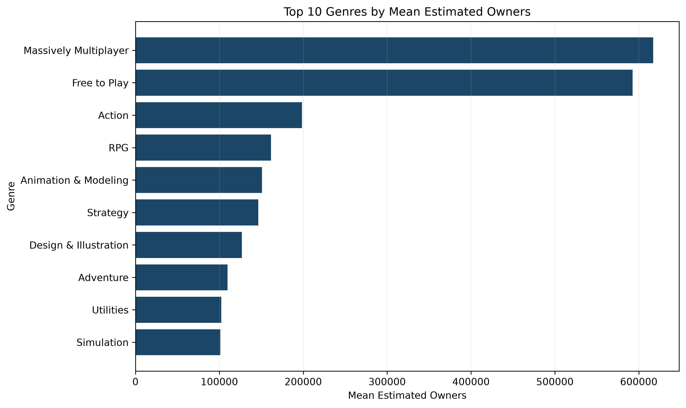
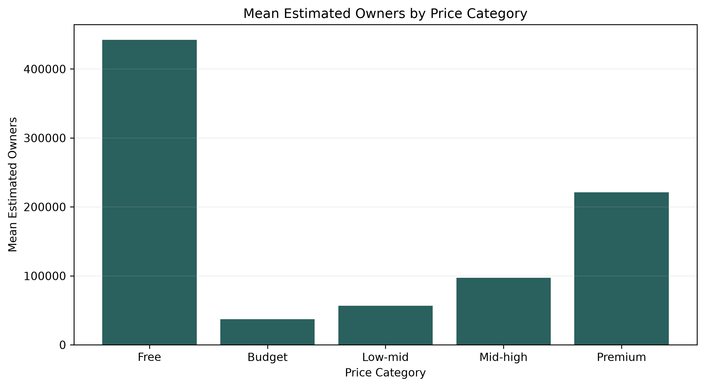
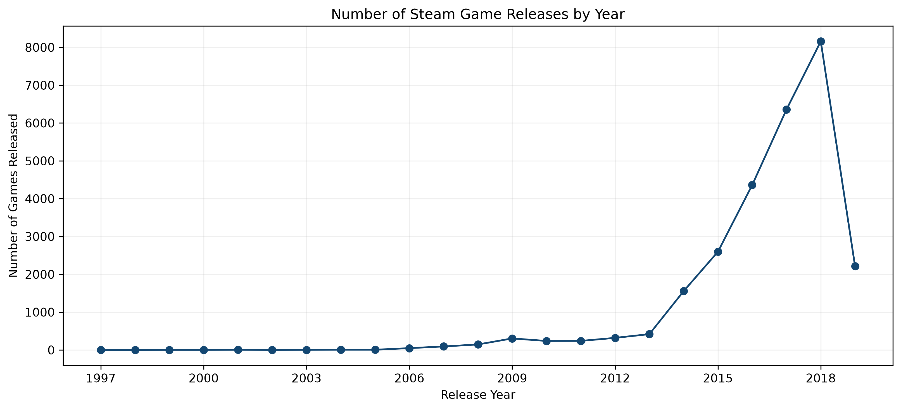

# Steam Games Analytics

Анализ данных об играх Steam с использованием Python, Pandas и Matplotlib.

## О проекте

Цель проекта — исследовать популярность игр Steam и определить, как она связана с жанрами, ценами и пользовательскими оценками. Также рассмотрим динамику выпуска игр и выделим характеристики наиболее популярных проектов.

## Данные

В исследовании использован датасет https://www.kaggle.com/datasets/nikdavis/steam-store-games/data, содержащий 27 075 игр и 18 исходных признаков.

Данные включают информацию о жанрах, датах выпуска, ценах, количестве владельцев, положительных и отрицательных отзывах и времени игры.

## Исследовательские вопросы

1. Какие жанры игр наиболее популярны?
2. Как цена игры связана с её популярностью и пользовательскими оценками?
3. Какие игры получают наиболее положительные оценки пользователей?
4. Как изменялось количество выпускаемых игр в Steam с течением времени?
5. Какие характеристики отличают самые популярные игры?

## Основные результаты

**Популярность жанров**

По среднему и медианному количеству владельцев лидируют `Massively Multiplayer` и `Free to Play`. Также выделяется `Action`, который входит в топ-10 по среднему количеству владельцев и по количеству выпущенных игр.

**Цена и популярность**

Бесплатные игры лидируют по среднему количеству владельцев, а игры категории `Premium` занимают второе место. При этом средняя доля положительных отзывов между ценовыми категориями различается относительно слабо.

**Пользовательские оценки**

Среди игр с не менее чем 1000 отзывов высокую долю положительных оценок имеют `Hidden Star in Four Seasons` (98,73%) и `Portal 2` (98,65%).

При оценке пользовательских отзывов важно учитывать не только долю положительных оценок, но и их общее количество.

**Динамика выпуска игр**

Начиная с 2014 года количество выпускаемых игр в Steam значительно выросло. Максимальное количество релизов в рассматриваемых данных приходится на 2018 год — 8 160 игр.

**Характеристики популярных игр**

Игры с приблизительным количеством владельцев более 150 000 в среднем дороже остальных (£8,81 против £5,82) и имеют более высокую среднюю долю положительных отзывов (76,95% против 70,93%).

## Рекомендации

По результатам анализа стоит обратить внимание на ценовые категории `Free` и `Premium`, а также жанры `Massively Multiplayer`, `Free to Play` и `Action`.

При этом выявленные закономерности не гарантируют популярности новой игры и не доказывают прямого влияния цены или жанра на количество владельцев.

## Ограничения исследования

Количество владельцев в исходном датасете представлено диапазонами. Для анализа использовалась середина диапазона (`owners_mid`), поэтому полученные значения являются приблизительными.

Данные отражают исторический период, представленный в датасете, и не описывают текущее состояние Steam. Информация за 2019 год неполная.

## Инструменты

Python, Pandas, NumPy, Matplotlib, Jupyter Notebook.

## Запуск проекта

Основной анализ находится в `analysis.ipynb`.

Для запуска необходимо установить Python и используемые библиотеки (`pandas`, `numpy`, `matplotlib`), открыть ноутбук в Jupyter Notebook или VS Code и выполнить все ячейки по порядку.

Исходный файл данных: `data/steam.csv`.